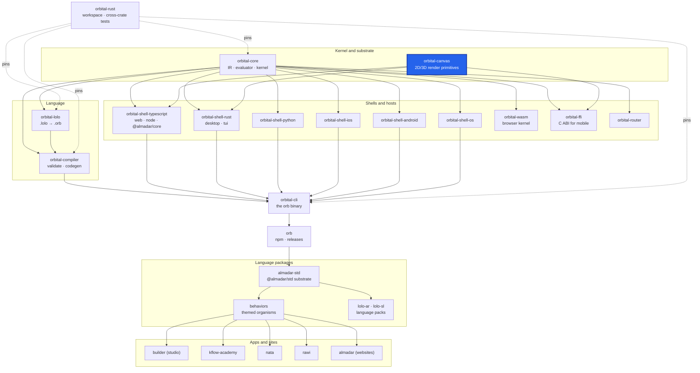

<div align="center">

# orbital-canvas

**The shared `wgpu` renderer that paints Almadar game and diagram canvases from a JSON display list.**

[](https://github.com/almadar-io/orbital-canvas/actions/workflows/ci.yml)
[](LICENSE)

</div>

One GPU renderer for Rust desktop, Android and iOS, reached through a small C ABI. The server or runtime sends a JSON `GameRenderPacket` (a display list); this crate turns it into draw calls. It also rasterizes SVG sprites and vector paths and shapes text (joining, bidi, per-script fonts).

## Where this fits



| Upstream (this repo depends on) | Downstream (depends on this repo) |
|---|---|
| [orbital-core](https://github.com/almadar-io/orbital-core): it uses the `orbital-core-base` layer | [orbital-ffi](https://github.com/almadar-io/orbital-ffi): re-exports the renderer C ABI for the mobile shells |
| | [orbital-shell-typescript](https://github.com/almadar-io/orbital-shell-typescript) and [orbital-shell-rust](https://github.com/almadar-io/orbital-shell-rust): paint canvases with it (per the architecture) |

## Quick start

The crate reads the Almadar language data from installed npm packages, so install those first. The toolchain is pinned to Rust 1.93.0 in `rust-toolchain.toml`.

```bash
npm install --no-save --no-package-lock @almadar/core@^10 @almadar/std@^16 @almadar/lolo-ar@^1 @almadar/lolo-sl@^1
cargo test
```

Two examples dump a render packet as JSON: `cargo run --example dump-canvas-packet` and `cargo run --example dump-learning-scene`.

## What's inside

| Path | Purpose |
|---|---|
| `src/packet.rs`, `src/projector.rs` | The `GameRenderPacket` display list and its projection |
| `src/renderer.rs` | `SharedDeviceRenderer`, the `wgpu` renderer |
| `src/c_api.rs` | The C ABI the native hosts call |
| `src/mappers/` | Pattern mappers: game canvas 2D, isometric, platformer, mini map, scene, diagram, learning |
| `src/svg.rs`, `src/vector.rs`, `src/atlas.rs`, `src/animate.rs`, `src/asset.rs` | SVG sprites, vector layer (paths, strokes, text), atlases, animation, asset loading |
| `src/platform/` | Android and iOS surface glue |

Cargo features (all off by default): `http` (HTTP(S) asset fetching, native only) and `system-fonts` (desktop hosts supply scripts the bundled faces lack from the installed system fonts).

## Development

- Test with `cargo test`; CI (`.github/workflows/ci.yml`) runs it on push and pull request to `main`.
- Open gaps are tracked in [`Almadar_Gaps.md`](Almadar_Gaps.md). Work on `main` only; there are no feature branches.
- Inside the monorepo this repo is the submodule `orbital-rust/crates/orbital-canvas`.

## Docs

- [Orb documentation](https://orb.almadar.io/docs): the language, the `orb` CLI and how the pieces fit

## License

[Business Source License 1.1](LICENSE): free for non-commercial use and internal evaluation; commercial production use needs a licence from Almadar FZE. Converts to Apache-2.0 on 2030-02-01.
